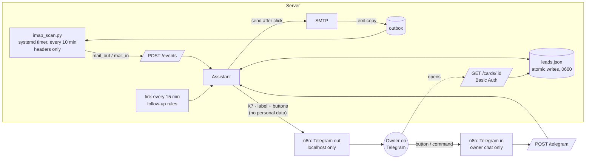

# ai-sales-assistant

A **human-in-the-loop sales assistant** for a one-person business. All contacts sit in one pipeline, fed by the mailbox, bookings and notes sent to a Telegram bot. The assistant **drafts** follow-ups and review requests. **A human clicks Send.** Nothing goes to a client automatically.

It runs in production for my business (AtomFlow) as part of a larger Express backend. This repository is a cleaned-up, standalone extract: same logic, fictional data, no secrets.

## Why it is built this way

| Decision | Reason |
|---|---|
| **The bot drafts, a human sends** | Every client email is approved with one tap. The privacy policy promises it, and a wrong automated follow-up costs more than a minute of review. |
| **Mailbox: headers only** | The IMAP scanner reads `From/To/Subject/Date/Message-ID/References` with `BODY.PEEK`. Message bodies never leave the server and never reach an AI model. |
| **Telegram never sees personal data** | Telegram is outside the EEA and not a listed data processor. Messages carry a contact number (`K7`) and a neutral label. Names, emails and phones are on a card behind a login. `assertNoPersonalData()` refuses to send a message that contains an email address or a phone number. |
| **Consent is explicit** | Sending someone an email does not prove they asked for it. A lead created from the Sent folder has no consent until the owner fills it in, and without consent follow-ups are refused. |
| **Bot token stays in n8n** (optional) | In `TELEGRAM_MODE=n8n` the assistant talks to Telegram through two n8n workflows. The token lives only in n8n credentials, and the outbound webhook accepts requests from localhost only. |

## Architecture



### Follow-up rules (`src/scheduler.ts`)

- Only for leads with status **offer**, an email address, and no draft already waiting.
- First reminder after **5 working days** without a reply, second after **7**, never more than **2**.
- A reply from the contact (`mail_in` after the last `mail_out`) stops reminders. "no / unsubscribe / nie / wypisz" in the subject marks an **opt-out**.
- Drafts are created only Mon–Fri 8:00–17:00 (Europe/Warsaw). Follow-ups stay in the original thread (`In-Reply-To` / `References`).

### Telegram buttons

| Callback | Action |
|---|---|
| `S:K7:offer` (call, won, delivered, lost, later) | change status. `delivered` drafts a review request |
| `W:K7` | send the waiting draft (refused without consent / for opt-outs) |
| `Z:K7` | snooze 7 days |
| `P:K7` | skip the draft |

Commands: `/list`, `/new hair salon, Opole` (description **without** names), `#K7 called, wants online booking` (note).

## Run it

```bash
npm install
npm test            # TypeScript strict build + 8 tests (privacy guard, scheduler, consent, threading, chat check)
cp .env.example .env && npm run build && node --env-file=.env dist/src/server.js
```

Scanner (Python 3, standard library only), e.g. from a systemd timer:

```bash
IMAP_HOST=… IMAP_USER=… IMAP_PASS=… EVENT_TOKEN=… python3 scanner/imap_scan.py --dry-run
```

n8n relay (optional): import `n8n/telegram-in.json` and `n8n/telegram-out.json`, attach your Telegram credential and replace the `REPLACE_…` placeholders.

## Project layout

```
src/assistant.ts   commands, buttons, mailbox events, follow-up tick
src/scheduler.ts   working days and follow-up rules (pure functions)
src/privacy.ts     guard: no emails / phone numbers in Telegram messages
src/store.ts       lead pipeline, JSON store with atomic writes
src/drafts.ts      email templates (Polish — the business is in Poland)
src/mailer.ts      SMTP + .eml copy for the Sent folder
src/telegram.ts    Bot API or n8n relay transport
src/server.ts      Express: /telegram, /events, /cards/:id
scanner/           IMAP header scanner
n8n/               relay workflows (sanitized)
examples/          fictional pipeline
```

## Results in production

- **22 contacts** in the first 2 weeks after launch (October 2026), from the mailbox, bookings and notes.
- The mailbox is scanned every 10 minutes. Sent offers and replies update statuses without manual input.
- Zero emails sent without approval, by design.

---

Built by **Marcin Pakuła**, [AtomFlow](https://atomflow.pl): process automation and AI deployments. MIT License.
